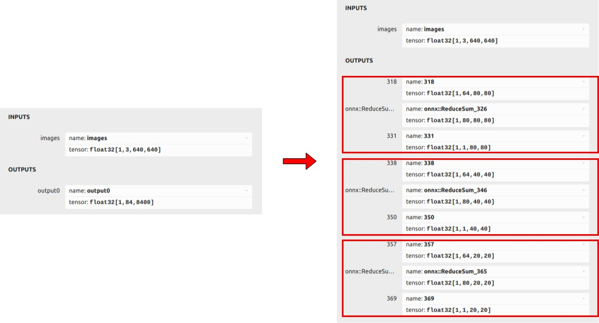
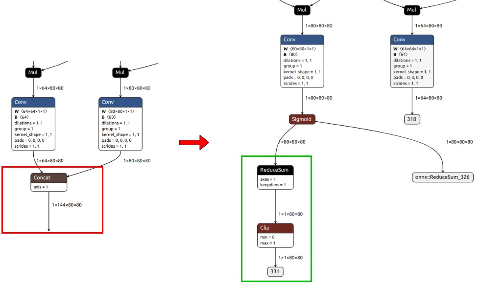
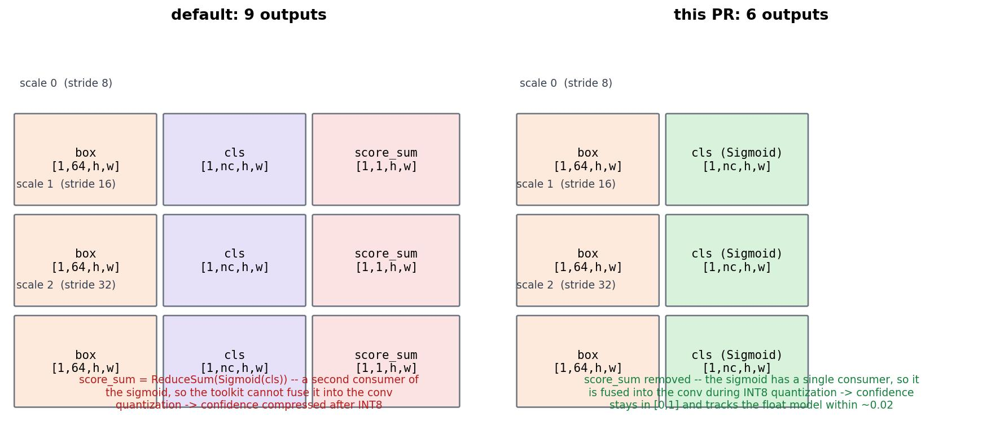
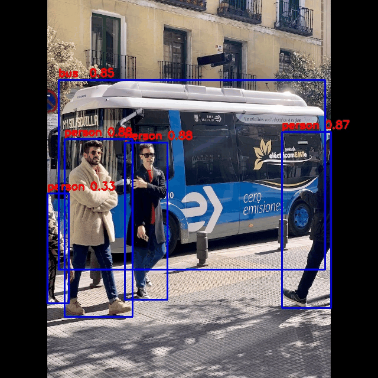
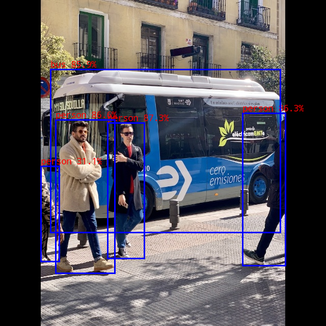

# yolov8

## Table of contents

- [1. Description](#1-description)
- [2. Current Support Platform](#2-current-support-platform)
- [3. Pretrained Model](#3-pretrained-model)
- [4. Convert to RKNN](#4-convert-to-rknn)
- [5. Python Demo](#5-python-demo)
- [6. Android Demo](#6-android-demo)
  - [6.1 Compile and Build](#61-compile-and-build)
  - [6.2 Push demo files to device](#62-push-demo-files-to-device)
  - [6.3 Run demo](#63-run-demo)
- [7. Linux Demo](#7-linux-demo)
  - [7.1 Compile and Build](#71-compile-and-build)
  - [7.2 Push demo files to device](#72-push-demo-files-to-device)
  - [7.3 Run demo](#73-run-demo)
- [8. Expected Results](#8-expected-results)


## 1. Description

The model used in this example comes from the following open source projects:  

https://github.com/airockchip/ultralytics_yolov8


## 2. Current Support Platform

RK3562, RK3566, RK3568, RK3576, RK3588, RV1126B, RV1109, RV1126, RK1808, RK3399PRO


## 3. Pretrained Model

Download link: 

[./yolov8n.onnx](https://ftrg.zbox.filez.com/v2/delivery/data/95f00b0fc900458ba134f8b180b3f7a1/examples/yolov8/yolov8n.onnx)<br />[./yolov8s.onnx](https://ftrg.zbox.filez.com/v2/delivery/data/95f00b0fc900458ba134f8b180b3f7a1/examples/yolov8/yolov8s.onnx)<br />[./yolov8m.onnx](https://ftrg.zbox.filez.com/v2/delivery/data/95f00b0fc900458ba134f8b180b3f7a1/examples/yolov8/yolov8m.onnx)

Download with shell command:

```
cd model
./download_model.sh
```

**Note**: The model provided here is an optimized model, which is different from the official original model. Take yolov8n.onnx as an example to show the difference between them.
1. The comparison of their output information is as follows. The left is the official original model, and the right is the optimized model. As shown in the figure, the original one output is divided into three groups. For example, in the set of outputs ([1,64,80,80],[1,80,80,80],[1,1,80,80]), [1,64,80,80] is the coordinate of the box, [1,80,80,80] is the confidence of the box corresponding to the 80 categories, and [1,1,80,80] is the sum of the confidence of the 80 categories.

<div align=center>
  
</div>

2. Taking the the set of outputs ([1,64,80,80],[1,80,80,80],[1,1,80,80]) as an example, we remove the subgraphs behind the two convolution nodes in the model, keep the outputs of these two convolutions ([1,64,80,80],[1,80,80,80]), and add a reducesum+clip branch for calculating the sum of the confidence of the 80 categories ([1,1,80,80]).

<div align=center>
  
</div>

### 3.1 Optional: export the 6-output variant

Besides the 9-output layout above, the example also supports a **6-output**
variant that drops `score_sum` and keeps `Sigmoid(cls)` fused inside the graph:

```
[box(1, 64, h, w), cls(1, nc, h, w)] x 3 scales   ->  6 outputs
```

<div align=center>
  
</div>

`score_sum = ReduceSum(Sigmoid(cls))` is only a pre-filter for the post-processor.
It is also a *second consumer* of `Sigmoid(cls)`, which prevents the RKNN toolkit
from fusing the sigmoid into the preceding convolution during INT8 quantization.
When the fusion is blocked, the sigmoid output is quantized on its own and the
INT8 confidence is both compressed at the top of its range and stair-stepped
(e.g. PyTorch 0.98 -> RKNN 0.58~0.90). If `cls` is exported as raw logits instead
(the pre-sigmoid value), the logit range is dominated by the deep negative
background values, which makes the coarse confidence grid even worse.

Removing `score_sum` leaves the sigmoid with a single consumer, so the toolkit
fuses it into the conv: the INT8 confidence stays in `[0, 1]` and tracks the float
model (within ~0.02).

Both the C++ (`cpp/postprocess.cc`) and Python (`python/yolov8.py`) post-processors
handle the two layouts automatically — with `n_output == 6`, `output_per_branch ==
2` and the optional `score_sum` is simply disabled.

Export a 6-output model from a PyTorch checkpoint with:

```shell
cd python
python export_onnx.py <model.pt> <model_6out.onnx> [imgsz] [opset]
# e.g.
python export_onnx.py yolov8n.pt yolov8n_6out.onnx 640 17
```

Then convert it to RKNN with `convert.py` exactly like the 9-output model (see
[3.2](#32-quantization-notes-6-output-model) for the calibration-set requirements
that the INT8 confidence depends on). Example result of the exported 6-output
`yolov8n` on `model/bus.jpg`:

<div align=center>
  
</div>

### 3.2 Quantization notes (6-output model)

The 6-output layout only pays off if the INT8 calibration is done right:

- **Calibration set must match the deployment preprocessing.** rknn-toolkit2
  stretches the calibration images to the model input size directly (it does not
  letterbox). If the deployment pre-processing letterboxes with gray-114 padding
  while the calibration images are stretched, the model is quantized on a
  different input distribution than the one it sees at inference and the
  confidence can collapse (e.g. PyTorch 0.98 -> RKNN ~0). Fix: pre-letterbox the
  calibration images to 640x640 with gray-114 padding so that the toolkit's
  stretch becomes a no-op.
- **Input convention.** Feed `uint8 [0, 255]` with `mean=0 / std=255` so the
  normalization happens inside the model graph. Do not feed float `[0, 1]` with a
  different mean/std.
- **Calibration set composition.** Include high-confidence samples (PyTorch
  conf >= 0.9). The top of the output quantization range is decided by the
  calibration distribution; a handful of high-confidence samples will not move
  the quantile. Keep the calibration domain the same as the deployment domain
  (video frames vs still photos have different statistics).


## 4. Convert to RKNN

*Usage:*

```shell
cd python
python convert.py <onnx_model> <TARGET_PLATFORM> <dtype(optional)> <output_rknn_path(optional)>

# such as: 
python convert.py ../model/yolov8n.onnx rk3588
# output model will be saved as ../model/yolov8.rknn
```

*Description:*

- `<onnx_model>`: Specify ONNX model path.
- `<TARGET_PLATFORM>`: Specify NPU platform name. Such as 'rk3588'.
- `<dtype>(optional)`: Specify as `i8`, `u8` or `fp`. `i8`/`u8` for doing quantization, `fp` for no quantization. Default is `i8`.
- `<output_rknn_path>(optional)`: Specify save path for the RKNN model, default save in the same directory as ONNX model with name `yolov8.rknn`


## 5. Python Demo

*Usage:*

```shell
cd python
# Inference with PyTorch model or ONNX model
python yolov8.py --model_path <pt_model/onnx_model> --img_show

# Inference with RKNN model
python yolov8.py --model_path <rknn_model> --target <TARGET_PLATFORM> --img_show
```

*Description:*

- `<TARGET_PLATFORM>`: Specify NPU platform name. Such as 'rk3588'.

- `<pt_model / onnx_model / rknn_model>`: Specify the model path.


## 6. Android Demo

**Note: RK1808, RV1109, RV1126 does not support Android.**

#### 6.1 Compile and Build

Please refer to the [Compilation_Environment_Setup_Guide](../../docs/Compilation_Environment_Setup_Guide.md#android-platform) document to setup a cross-compilation environment and complete the compilation of C/C++ Demo.  
**Note: Please replace the model name with `yolov8`.**

#### 6.2 Push demo files to device

With device connected via USB port, push demo files to devices:

```shell
adb root
adb remount
adb push install/<TARGET_PLATFORM>_android_<ARCH>/rknn_yolov8_demo/ /data/
```

#### 6.3 Run demo

```sh
adb shell
cd /data/rknn_yolov8_demo

export LD_LIBRARY_PATH=./lib
./rknn_yolov8_demo model/yolov8.rknn model/bus.jpg
```

- After running, the result was saved as `out.png`. To check the result on host PC, pull back result referring to the following command: 

  ```sh
  adb pull /data/rknn_yolov8_demo/out.png
  ```

- Output result refer [Expected Results](#8-expected-results).


## 7. Linux Demo

#### 7.1 Compile and Build

Please refer to the [Compilation_Environment_Setup_Guide](../../docs/Compilation_Environment_Setup_Guide.md#linux-platform) document to setup a cross-compilation environment and complete the compilation of C/C++ Demo.
**Note: Please replace the model name with `yolov8`.**

#### 7.2 Push demo files to device

- If device connected via USB port, push demo files to devices:

```shell
adb push install/<TARGET_PLATFORM>_linux_<ARCH>/rknn_yolov8_demo/ /userdata/
```

- For other boards, use `scp` or other approaches to push all files under `install/<TARGET_PLATFORM>_linux_<ARCH>/rknn_yolov8_demo/` to `userdata`.

#### 7.3 Run demo

```sh
adb shell
cd /userdata/rknn_yolov8_demo

export LD_LIBRARY_PATH=./lib
./rknn_yolov8_demo model/yolov8.rknn model/bus.jpg
```

- After running, the result was saved as `out.png`. To check the result on host PC, pull back result referring to the following command: 

  ```
  adb pull /userdata/rknn_yolov8_demo/out.png
  ```

- Output result refer [Expected Results](#8-expected-results).


## 8. Expected Results

This example will print the labels and corresponding scores of the test image detect results, as follows:

```
person @ (211 241 283 507) 0.873
person @ (109 235 225 536) 0.866
person @ (476 222 560 521) 0.863
bus @ (99 136 550 456) 0.859
person @ (80 326 116 513) 0.311
```



- Note: Different platforms, different versions of tools and drivers may have slightly different results.
